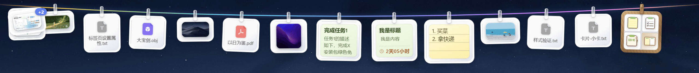
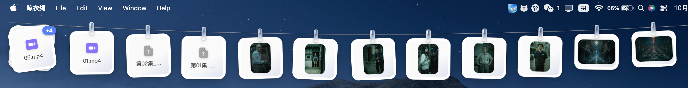

<p align="center">
  
</p>

<h1 align="center">file-line (Clothesline for Files)</h1>

<p align="center">A transparent virtual clothesline pinned to the top of your screen. Drag, drop, and "hang" screenshots, files, and folders. Click to copy, double-click to open, drag out to share.</p>

<p align="center">
  <a href="README.md">English</a> · <a href="docs/README.zh.md">中文</a>
</p>

### windows


### mac


> If the Mac version reports the file is damaged after installation, run the following command in the terminal:
>
> ```bash
> sudo xattr -rd com.apple.quarantine "/Applications/FileLine.app"
> ```

### Demo Video

<video src="public/readme/file-line.mp4" controls width="720"></video>

> If your platform can't play the embedded video, watch the file directly: [public/readme/file-line.mp4](public/readme/file-line.mp4)

## Features

- **Drag to hang**: Drag files or folders directly onto the line and watch them turn into cards pinned up.
- **Auto-hang screenshots**: Screenshots are automatically pinned to the line.
- **Card interactions**:
  - **Click**: Copy (images go to the clipboard, files go to the file list)
  - **Double-click**: Open with the default application
  - **Hold and drag out**: Drop into chat windows, the desktop, or anywhere else
  - **Right-click menu**: Open / Open containing folder / Remove / Remove all to the left / Remove all to the right / Save as / Clear the line
- **Todo cards**: New todos are hung on the line. Hover a card to check it done / undo it; done cards turn gray with a strikethrough.
- **Tray**: Double-click the tray icon to show/hide the line. Right-click the tray menu to enable auto-start, switch card size (Small / Medium / Large), or quit.
- **Auto-hide**: Slides off-screen when idle and reappears when you hover near the top of the screen. It also pops out instantly when you're dragging files toward the top.
- **Persistent state**: The card list is saved automatically and restored exactly as it was when you relaunch the app.

## Requirements

- Windows 10 / 11 (requires the WebView2 Runtime; it's preinstalled on Win11 and recent Win10)
- [Node.js](https://nodejs.org/) 18+ (20 LTS recommended)
- [Rust](https://www.rust-lang.org/tools/install) stable (1.78+ recommended, with the MSVC toolchain target)
- About 3 GB of free disk space for the Rust compilation cache (`src-tauri/target`)

## Development

```bash
# 1. Install dependencies
npm install

# 2. Start in dev mode (the first run compiles Rust, which takes a few minutes)
npm run tauri dev
```

- Edit frontend code under `src/`: Vite hot reload — changes take effect immediately.
- Edit Rust code under `src-tauri/`: The app automatically recompiles and restarts.

> If pulling rust dependencies is slow, try setting `CARGO_HTTP_MULTIPLEXING=false`, or see [RsProxy](https://rsproxy.cn/) for mirror configuration.

## Building for Release

```bash
npm run tauri build
```

After the build completes, the artifacts are located at:

| Artifact | Path |
| --- | --- |
| NSIS installer | `src-tauri\target\release\bundle\nsis\FileLine_1.0.0_x64-setup.exe` |
| Portable single exe | `src-tauri\target\release\FileLine.exe` |
| Max app | `src-tauri\target\release\FileLine_1.0.0_aarch64` |

- **Installer**: Double-click to install; includes Start Menu and uninstaller entries. The version number follows the `version` field in `tauri.conf.json` and `Cargo.toml`.
- **Portable**: A single exe — copy it anywhere and use it without installation.

## Basic Usage

### Show / Hide

| Action | Description |
| --- | --- |
| Double-click the tray icon | Show or hide the clothesline |
| Hover the mouse near the top of the screen | The line appears after a brief pause |
| Take a screenshot or copy a file | The line appears automatically and the new file is hung up |
| Idle for about 2 seconds | The line slides back to hide; your content is preserved |

### Hanging Up Cards

| Action | Description |
| --- | --- |
| Drag files/folders to the top of the screen | Release to hang them on the line |
| Copy images or files to the clipboard | They are automatically pinned as new cards |

### Tray Menu (right-click the tray icon)

| Action | Description |
| --- | --- |
| Auto-start on boot | Launch with the system automatically |
| Card size | Switch between Small / Medium / Large |

### Card Operations

| Action | Description |
| --- | --- |
| Click a card | Copy that file to the clipboard |
| Double-click a card | Open with the default program |
| Drag the clothespin on a card | Slide it left or right along the line to reorder |
| Hold and drag a card outward | Drop it into a chat window or editor as a file |
| Right-click a card | Open, locate, remove, save all as, etc. |
| Hover the × at the top-right of a card | Remove that card |
| Hover a todo card | Check it done / undo it; done cards turn gray with a strikethrough |

### Browsing History

| Action | Description |
| --- | --- |
| Scroll the wheel on the line | Slide left/right to see earlier cards |
| Click the collapsed stacks at either end | Expand the list and jump to a specific card |

## FAQ

- **Tray/window icon not updating**: Explorer caches icons. Restart explorer or wait a moment.
- **Screenshots don't appear on the line**: Confirm the app is running (the tray icon is visible). Some third-party screenshot tools don't write to the system clipboard listener — paste or drag in manually.
- **Want auto-start on boot**: Right-click the tray icon → enable "Auto-start on boot".

## Tech Stack

Tauri 2 + React 18 + TypeScript + Vite 6
